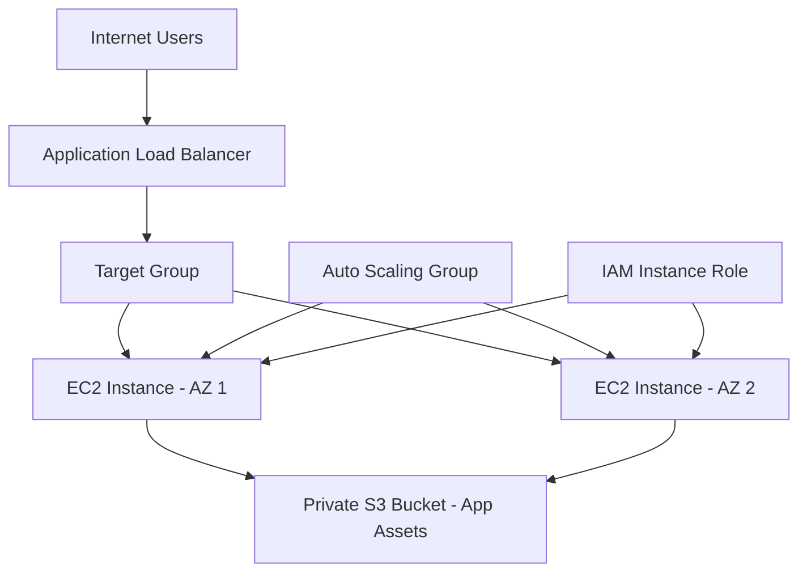

# Avora AWS Architecture

Avora is a fictional healthcare appointment platform demo deployed on AWS using Terraform.

## Architecture

## AWS Resources
- VPC with CIDR range 10.0.0.0/16.
- Internet gateway and two public subnets across separate Availability Zones.
- Application Load Balancer distributing HTTP traffic.
- Auto Scaling Group maintaining two instances, with a maximum of three.
- EC2 instances running Nginx.
- Private S3 bucket storing HTML, CSS and JavaScript assets.
- IAM instance role allowing EC2 to retrieve assets from S3.
## High Availability Test
One Auto Scaling Group instance was deliberately terminated without reducing desired capacity. The group launched a replacement automatically. Both instances became healthy, and the public application remained accessible.
## Design Decisions
- No NAT Gateway, to avoid NAT Gateway charges.
- No direct SSH access; administration uses AWS Systems Manager Session Manager.
- S3 assets are private and accessed through IAM permissions.
- Terraform state is stored locally and excluded from version control.
- AWS resources incur charges while running. Use terraform destroy when finished.
## Application Limitations
Avora is a frontend demonstration, not a production healthcare system.
- Provider profiles and schedules are fictional.
- Appointments and notes are stored in browser local storage.
- There is no backend API, database, real authentication or secure medical-record storage.
- Do not enter real patient or sensitive personal information.
